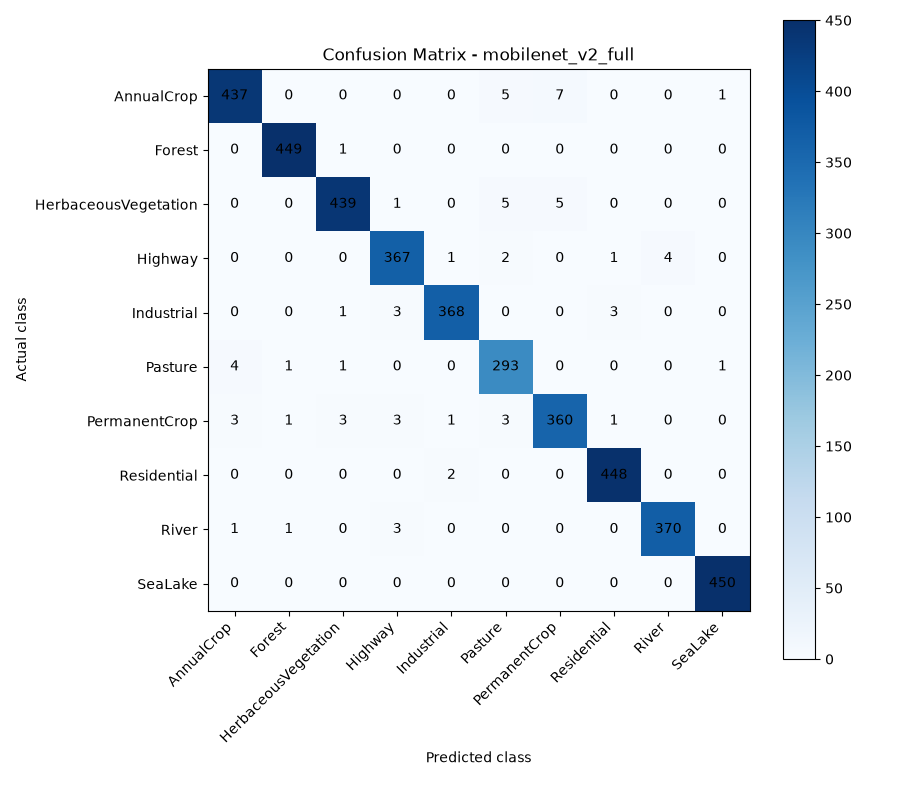
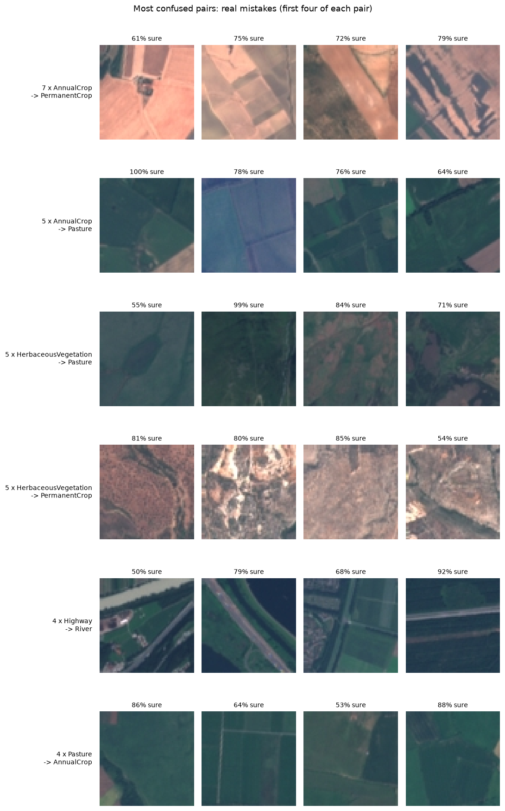
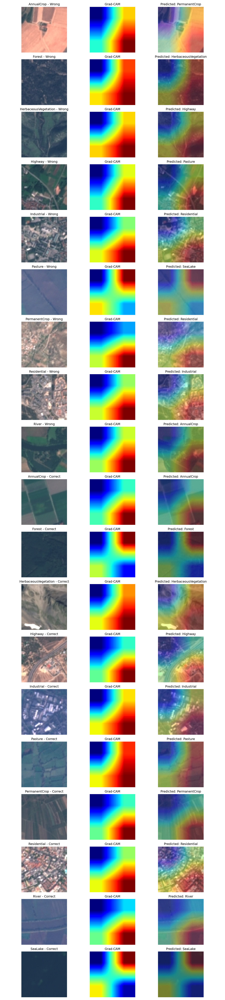
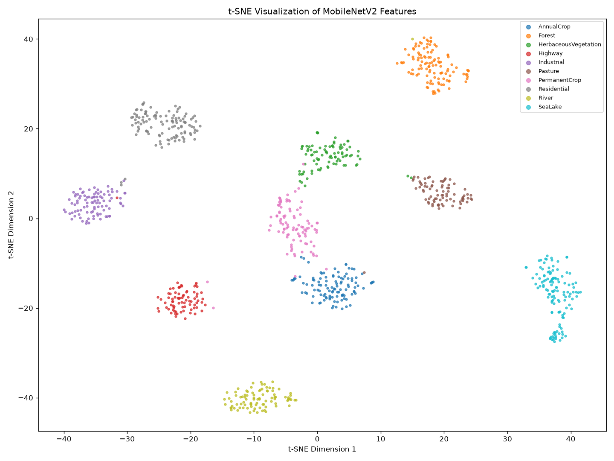

# Error analysis and explainability: draft

> **Status: DRAFT, not yet confirmed by Rohan.** Part E belongs to Rohan. He is away, so Nitin had this first draft written with Claude from Rohan's real saved results (`results/mobilenet_v2_full_frac1_seed0_*.csv`, `results/misclassified_images.csv`) and from `notebooks/04_evaluation_and_explainability.ipynb`. Rohan's own write-up is `results/part_e_analysis.md` (corrected by Nitin on 2026-11-05, see the note at its top); this draft is the report-ready version and both use the same numbers. Rohan must read this draft, check every number against the notebook, and rewrite anything he does not agree with before it goes into the report. Disclosure: `docs/ai_usage.md`.

## 1. What we evaluated

We analyse our best transfer model on the validation set, **MobileNetV2 fully fine-tuned** (`mobilenet_v2_full`, seed 0, trained on all 18,900 training images). It is scored on the 4,050 test images that were never used for training or for choosing the model. Everything below comes from this one model and this one seed.

## 2. Overall result

| Measure | Value |
|---|---|
| Correct test images | 3,981 of 4,050 |
| Test accuracy | 98.30% |
| Macro-F1 | 0.982 |
| Mistakes | 69 (1.7%) |

We report macro-F1 next to accuracy because it gives every class the same weight. Accuracy is dominated by the large classes (the test set has 450 images of some classes and only 300 of Pasture).

## 3. Which classes are hard

| Class | Precision | Recall | Test images |
|---|---|---|---|
| PermanentCrop | 0.968 | 0.960 | 375 |
| AnnualCrop | 0.982 | 0.971 | 450 |
| HerbaceousVegetation | 0.987 | 0.976 | 450 |
| Pasture | 0.951 | 0.977 | 300 |
| Highway | 0.973 | 0.979 | 375 |
| Industrial | 0.989 | 0.981 | 375 |
| River | 0.989 | 0.987 | 375 |
| Residential | 0.989 | 0.996 | 450 |
| Forest | 0.993 | 0.998 | 450 |
| SeaLake | 0.996 | 1.000 | 450 |

SeaLake, Forest and Residential are almost perfect. The weakest recall is PermanentCrop (0.960). Pasture has the lowest precision (0.951): other green classes get called Pasture more often than Pasture gets missed.

## 4. Where the mistakes are

The 69 mistakes fall into 29 different (actual, predicted) pairs. The largest are:

| Mistakes | Actual class | Predicted as |
|---|---|---|
| 7 | AnnualCrop | PermanentCrop |
| 5 | AnnualCrop | Pasture |
| 5 | HerbaceousVegetation | Pasture |
| 5 | HerbaceousVegetation | PermanentCrop |
| 4 | Highway | River |
| 4 | Pasture | AnnualCrop |

The six biggest pairs are 30 of the 69 mistakes (43%). **36 of the 69 mistakes (52%) are between the four crop and vegetation classes** (AnnualCrop, PermanentCrop, Pasture, HerbaceousVegetation). The brief expected AnnualCrop against PermanentCrop and Highway against River; our data shows both, but the most common single confusion is AnnualCrop -> PermanentCrop, and Pasture is involved in three of the six biggest pairs.

*Why, as far as we can tell (we looked at the examples, we did not run a test for it).* Many of the mistaken crop tiles show bare or dark ground, a field edge, or a mix of several fields. At 64 x 64 pixels (10 m per pixel) the difference between a field that is ploughed every year and one with permanent trees is mostly a matter of fine texture, and some tiles are ambiguous even for a person. In the Highway -> River examples the road runs next to a river or water, so both classes are really in the tile. Because the dataset uses a random split, neighbouring patches of the same field can sit in training and test (see Limitations), which could make the real error rate on completely new areas higher.

**Confidence.** Correct answers average 99.0% confidence, wrong ones 76.3%. A rule "send to a human if under 80% sure" would catch 39 of the 69 mistakes, but it would also flag 60 correct answers. We looked at this threshold on the test set, so it is an illustration, not a tuned rule.

## 5. Grad-CAM: what the model looks at

**Method.** Grad-CAM (Selvaraju et al., 2017) was written by hand in `src/gradcam.py`. A forward hook keeps the feature maps of the last convolution block, a backward hook keeps the gradients of the predicted class score. The weight of each feature map is its gradient averaged over height and width, and the heat map is ReLU(sum of weight x feature map), resized to the image and overlaid. We use the last convolution block (`model.features[-1]`) because it is the deepest layer that still keeps spatial position: after it, the average pooling throws position away, and it holds the most class-specific features.

**Images chosen by a rule.** Rohan's `src/gradcam_all_classes.py` draws one mistake for each of the 9 classes that have mistakes (SeaLake has none) and, for each of the 10 classes, the first correctly classified test image in the order of `data/splits.csv`. His earlier figure (`results/figures/gradcam_examples.png`) shows the first four mistakes.

**What it shows, honestly.** The heat maps are soft blobs. For a 64 x 64 image the last block is only **2 x 2 cells**, so each map is a stretched 2 x 2 grid. For Forest and SeaLake we see the typical "cross" pattern with nothing to point at. For Highway the hottest part is the bare ground beside the road, not the road itself (as we read the picture). In most images the hottest part is the lower-right corner: in 160 of the 200 test images checked below the hottest quarter of the heat map is the bottom-right and in none of them the top-left.

**A check, because Grad-CAM is not proof.** We painted one patch of 25% of the pixels with the average colour and measured how much the confidence in the predicted class fell (200 test images, the first 20 of each class in the order of `data/splits.csv`; script `src/gradcam_sanity_check.py`, run with `python -m src.gradcam_sanity_check`):

| Patch hidden | Mean confidence drop | Prediction changed |
|---|---|---|
| Hottest 25% (by Grad-CAM) | 0.064 | 14 of 200 |
| Coldest 25% (by Grad-CAM) | 0.061 | 14 of 200 |
| Random 32 x 32 square | 0.089 | 17 of 200 |

Hiding the hottest area hurts no more than hiding the coldest (it hurt more for 109 images and less for 91). **So the heat maps did not find a part of the image that matters more than the rest**, and we treat them as pictures to look at, not as evidence of what the model "sees". Our explanation (not tested): land-cover classes are textures spread over the whole tile, so any quarter of the tile still shows the texture. (A first version of this check hid scattered random pixels; that was unfair to the heat map because scattered noise damages the image far more than one solid patch, so we dropped it.) Ideas we did not try: Grad-CAM on an earlier block with a finer grid, or enlarging the image before Grad-CAM.

## 6. t-SNE: how the features are organised

We took the 1,280 numbers per image that MobileNetV2 produces after global average pooling for 1,000 random test images (fixed seed 42) and reduced them to 2 dimensions with t-SNE (perplexity 30).

The 10 classes form 10 clear groups. PermanentCrop sits between HerbaceousVegetation and AnnualCrop with a few stray points, and a few Residential points sit at the edge of Industrial, which matches the confusion matrix. SeaLake has a small separate group. t-SNE **does not** show how far apart two groups really are or how large a group is; it only shows which points are neighbours, and a different seed or perplexity gives a different picture. The model was trained with these labels, so well-separated groups are expected; the picture shows that the features of unseen test images stay grouped, not that the classes are easy.

Rohan's own confidence-drop experiment (`src/gradcam_confidence_drop.py`) hid the hottest 20% of 50 correctly classified images and found a drop of 1.08 points (0.61 points when the same script was re-run on a second laptop; in 10 of the 50 images the model was even more confident after masking). It has no control, so on its own it does not show that the highlighted area matters; the check above is its control.

## 7. Limits of this analysis

- One model, one seed (seed 0). With 69 mistakes, differences like 4 against 5 are noise.
- The test set was used once, for this model only; none of the choices above fed back into training.
- Random split: patches of the same area may appear in train and test.
- The Grad-CAM check shows the heat maps are coarse here; it does not show the model is "wrong" to rely on texture.

## 8. Reference check (for Rohan)

- Selvaraju, R. R., Cogswell, M., Das, A., Vedantam, R., Parikh, D., & Batra, D. (2017). *Grad-CAM: Visual Explanations from Deep Networks via Gradient-Based Localization.* ICCV 2017, 618-626.
- van der Maaten, L., & Hinton, G. (2008). *Visualizing Data using t-SNE.* Journal of Machine Learning Research, 9, 2579-2605.

Please verify both against the originals before they go into the report's reference list.

## 9. Things Rohan must fix or confirm (found while checking his work)

1. ~~`src/visualize_tsne.py` comment says 2,000 images~~ Fixed on 2026-11-05 (the code takes 1,000 and this draft says 1,000). The plan (baton 6) said about 2,000; rerun with 2,000 if you want to match it.
2. The plan says to use the features before the last layer; his script does (global average pool, 1,280 numbers).
3. `results/part_e_analysis.md` is now your real write-up (PR 12). Nitin corrected its Grad-CAM wording and added section 5.1; please confirm, and decide whether the report uses it or this draft (they agree on the numbers).
4. Redo the numbers with the final weights after Gate 2 if the weights change, and check that this draft still matches.
5. Your log still has empty code notes (section 2), leftover template lines, and a "what I understood" part that covers only transfer learning (the plan asks about `train.py` and notebooks 02, 03 and 05). Your AI row should say what you checked, not that you will check.
