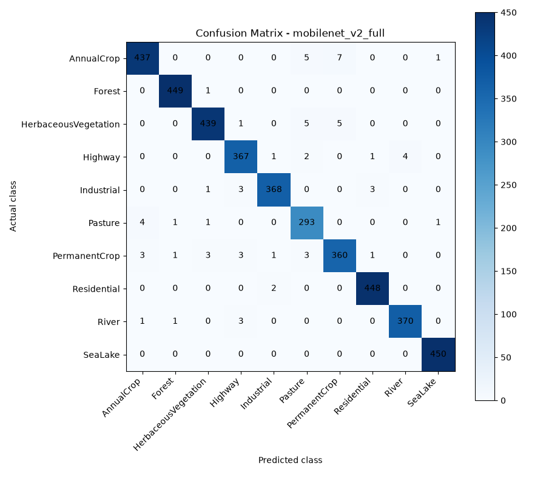
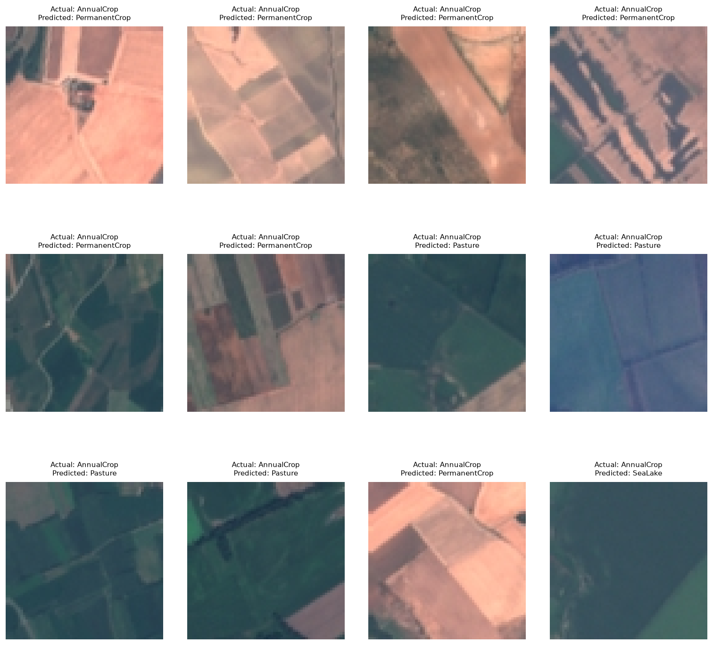
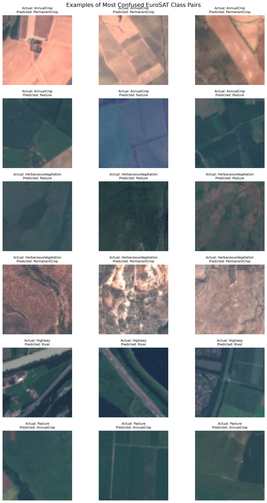
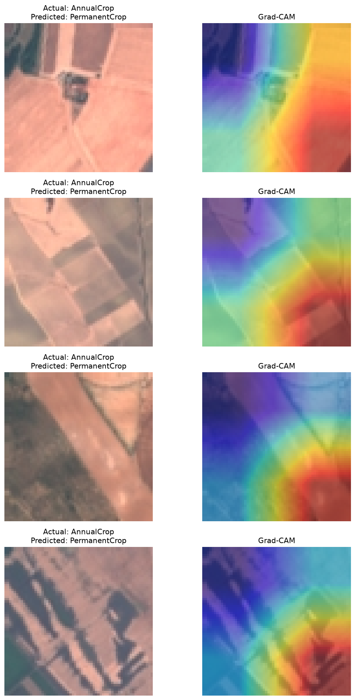
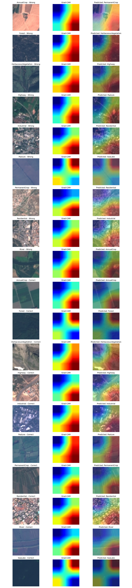
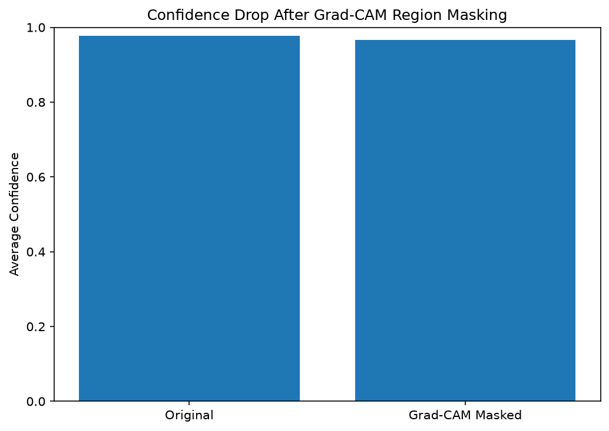
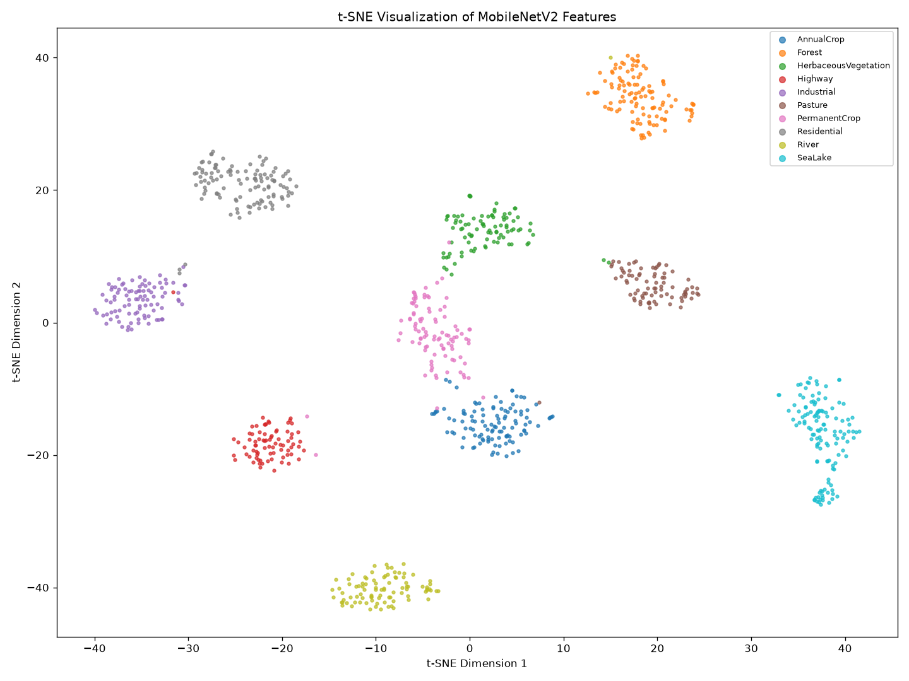

# Part E: Evaluation, Error Analysis, and Explainability

> **Corrections added by Nitin on 2026-11-05 (made with Claude, see `docs/ai_usage.md`). Rohan: please read and confirm.** The numbers in this file were checked against the saved results and are right. We changed the wording of the Grad-CAM parts (sections 4, 5 and 8) because the confidence-drop experiment had no control, and a control (section 5.1) shows that the Grad-CAM heat maps on this model do not point at a more important part of the image. We also added the weakest class to section 2 and marked reasons we did not test.

## 1. Model Evaluation

MobileNetV2 was evaluated on the fixed EuroSAT test set containing 4,050 satellite images across 10 land-use classes.

| Metric | Result |
|---|---:|
| Test Accuracy | 98.30% |
| Macro-F1 | 98.20% |
| Correct Predictions | 3,981 |
| Incorrect Predictions | 69 |
| Test Images | 4,050 |

The model achieved high accuracy and Macro-F1, indicating strong classification performance across the land-use classes.

## 2. Confusion Matrix Analysis

The confusion matrix shows that most classes were classified correctly.

- SeaLake: 450/450 correct.
- Forest: 449/450 correct.
- Residential: 448/450 correct.
- HerbaceousVegetation: 439/450 correct.
- AnnualCrop: 437/450 correct.
- PermanentCrop: 360/375 correct (the lowest recall of all classes, 0.960).

Agricultural classes showed the most confusion: 36 of the 69 mistakes (52%) are between AnnualCrop, PermanentCrop, Pasture and HerbaceousVegetation. A likely reason is that their images can contain similar vegetation patterns and field structures (we looked at examples but did not test this).

## 3. Misclassification Analysis

The model made 69 incorrect predictions.

The most frequent confusion pairs were:

| Actual Class | Predicted Class | Errors |
|---|---|---:|
| AnnualCrop | PermanentCrop | 7 |
| AnnualCrop | Pasture | 5 |
| HerbaceousVegetation | Pasture | 5 |
| HerbaceousVegetation | PermanentCrop | 5 |
| Highway | River | 4 |
| Pasture | AnnualCrop | 4 |

AnnualCrop, PermanentCrop, and Pasture can have similar textures and vegetation patterns. Highway and River can also appear similar because both may contain long, narrow structures.

### 3.1 Confused Class Pair Examples

The following figure presents representative misclassified images from six frequently confused class pairs. These examples help illustrate the visual similarity between land-use categories.

## 4. Grad-CAM Explainability

Grad-CAM was used to visualize image regions that influenced MobileNetV2 predictions.

The visualization contains:
- Original satellite image.
- Grad-CAM heatmap.
- Heatmap overlay on the original image.

Grad-CAM gives a rough picture of where the last convolution block responded. It is **not** a reliable explanation of the model's prediction here. For a 64 x 64 image the last MobileNetV2 block is only 2 x 2 cells, so every heat map is a stretched 2 x 2 grid. In our check on 200 test images (section 5.1) the hottest quarter of the heat map was the bottom-right in 80% of the images and the top-left in none, so the heat maps mostly show a position, not the content of the image.

### 4.1 Grad-CAM for All 10 Classes

Grad-CAM was generated for all 10 EuroSAT classes.

- 10 correctly classified images, one per class.
- 9 misclassified images, one per class where available.
- Total: 19 representative images.

Each example includes the original image, heatmap, and overlay with the predicted class. Most of the heat maps in this figure are hot in the lower-right part of the image, whatever the image shows (see section 5.1).

## 5. Grad-CAM Confidence-Drop Experiment

The confidence-drop experiment was performed on 50 correctly classified test images.

The top 20% of pixels with the highest Grad-CAM importance scores were masked.

| Measurement | Average Confidence |
|---|---:|
| Original | 97.72% |
| After Masking | 96.64% |
| Average Drop | 1.08 percentage points |

The confidence decreased very slightly after masking (1.08 points on Rohan's laptop). Re-running the same script on a second laptop gave 0.61 points on the same 50 images: only 4 of the 50 images changed noticeably, so the exact number is sensitive to tiny numeric differences. In 10 of the 50 images the model was even *more* confident after masking. **This experiment has no control, so by itself it does not show that the highlighted regions matter.** Section 5.1 adds the control.

The experiment should be interpreted cautiously because masking can introduce artificial patterns into satellite images.

### 5.1 Control experiment (added by Nitin with Claude)

`src/gradcam_sanity_check.py` (run with `python -m src.gradcam_sanity_check`) uses 200 test images: the first 20 of each class in the order of `data/splits.csv`. It hides a patch of 25% of the pixels with the average colour and measures how much the confidence in the predicted class falls. Each patch is one solid piece, so the three edits are equally rough:

| Patch hidden | Mean confidence drop | Prediction changed |
|---|---:|---:|
| Hottest 25% (Grad-CAM) | 0.064 | 14 of 200 |
| Coldest 25% (Grad-CAM) | 0.061 | 14 of 200 |
| Random 32 x 32 square | 0.089 | 17 of 200 |

Hiding the hottest area hurts no more than hiding the coldest (it hurt more for 109 images and less for 91). The hottest quarter of the heat map was the bottom-right in 160 of the 200 images (80%), the top-right in 36, the bottom-left in 4 and the top-left in none. **So on this model and image size, the Grad-CAM heat maps do not identify a more important part of the image.** Our guess (not tested): land-cover classes are textures spread over the whole tile, so any quarter of the tile still shows the texture, and the 2 x 2 map favours one corner. Ideas not tried: Grad-CAM on an earlier layer with a finer grid, or on enlarged images. (A first version of this control hid scattered random pixels. That was unfair, because scattered noise damages an image far more than one solid patch, so it was dropped.)

## 6. t-SNE Feature Visualization

MobileNetV2 feature representations were extracted for 1,000 test images and visualized using t-SNE.

The experiment used:
- 1,000 test images.
- Fixed random seed: 42.
- Perplexity: 30.
- MobileNetV2 feature dimension: 1,280.

t-SNE reduces high-dimensional features to two dimensions for visualization. Images with similar feature representations may appear close together.

The visualization helps examine class clustering and overlap. However, t-SNE distances should not be interpreted as exact measurements of similarity.

## 7. Data-Efficiency Experiment

Scratch CNN performance was evaluated using different training-data fractions.

An additional experiment was conducted using random seed 4 for fractions 5%, 10%, and 25%.

| Training Fraction | Images | Accuracy | Macro-F1 |
|---|---:|---:|---:|
| 5% | 945 | 74.69% | 73.96% |
| 10% | 1,890 | 81.68% | 80.92% |
| 25% | 4,725 | 87.43% | 86.81% |

Performance increased as more training images were used. This indicates that the scratch CNN benefits from additional training data.

Note (added by Nitin with Claude): `src/train_part_e.py` re-implements the training loop on the CPU. Re-running the 5% row with it on a second laptop gave 74.44% (committed: 74.69%). The same seed through the shared GPU `train()` gave 78.62% at 5%, 81.46% at 10% and 85.31% at 25% (not saved in `metrics.csv`). So scores on small training sets move by a few points from run to run, which is why the report uses several seeds.

## 8. Conclusion

MobileNetV2 achieved 98.30% test accuracy and 98.20% Macro-F1 on EuroSAT. Most classes were classified correctly, while agricultural categories showed the largest confusion.

Misclassification examples helped us see which classes are confused. The Grad-CAM heat maps are coarse (2 x 2 cells) and the control experiment (section 5.1) showed that they do not point at a more important part of the image, so we show them as pictures, not as proof of what the model sees.

The t-SNE visualization helped explore the structure of learned features. The data-efficiency experiment showed that scratch CNN performance improved with increased training data.

### Limitations

- The dataset contains a fixed set of land-use classes.
- Visually similar classes can still be confused.
- Grad-CAM on this model and image size is very coarse (2 x 2 cells) and mostly points to the lower-right of the image (section 5.1), so it is not evidence of model reasoning.
- t-SNE is a visualization technique and does not preserve all original feature relationships.
- Results on EuroSAT may not directly generalize to other satellite datasets.

### Possible Improvements

- Evaluate the model on additional satellite datasets.
- Investigate confusing agricultural class pairs.
- Compare different image resolutions.
- Explore additional explainability methods, for example Grad-CAM on an earlier layer or on enlarged images.
- Test performance on images from different geographical regions.
