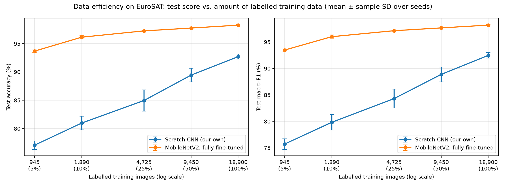
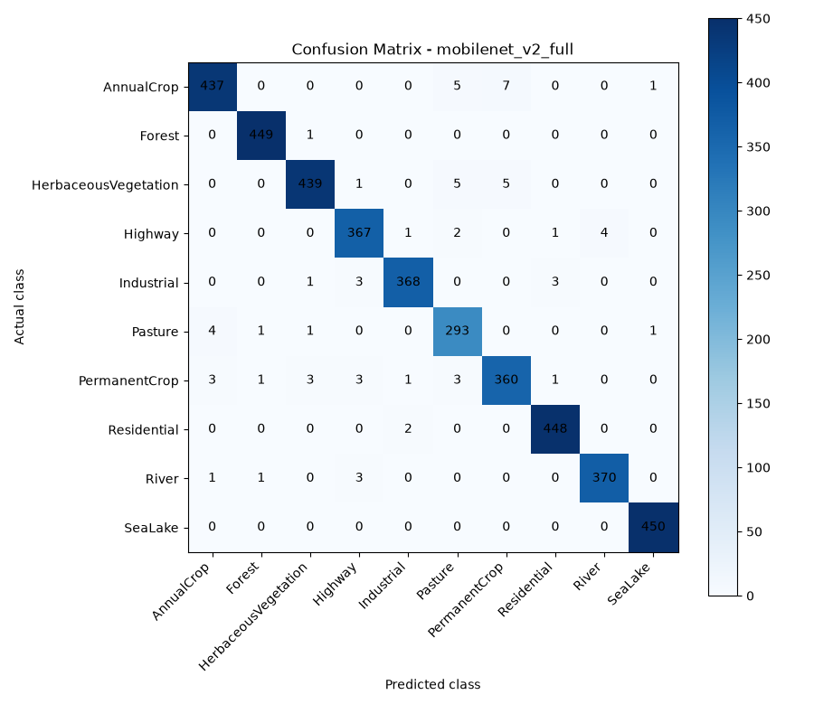

# Eyes in the Sky: Land-Use Classification from Satellite Images

**Group 5 capstone, Atria University, "Neural Network and CNN Sprint" (November 2026).**
A PyTorch project that teaches a CNN to look at a small satellite picture and say what the land is used for: crops, forest, river, houses, factories and so on.

| | |
|---|---|
| **Data** | [EuroSAT](https://github.com/phelber/EuroSAT) RGB: 27,000 Sentinel-2 satellite tiles, 64 x 64 pixels, 10 land-use classes |
| **Best model** | MobileNetV2 fine-tuned on EuroSAT: **98.27% test accuracy** (mean of 3 seeds, 4,050 test images never used for training) |
| **Our own CNN** | 3 convolution blocks, 94,986 parameters: **92.72%** |
| **Fewer labels** | With only 5% of the training images (945), the fine-tuned MobileNetV2 reaches **93.69%**, better than our own CNN trained on all 18,900 (92.72%) |
| **Demo** | An offline website: upload a tile, see the class, the top 3 guesses and a Grad-CAM picture |

> **What it can and cannot do.** It works on EuroSAT-style tiles (Sentinel-2, about 640 m across, top-down). It knows only the 10 classes below and always picks one of them. On other images (zoomed-in pictures, photos, Google Maps screenshots) it is guessing: in our test, accuracy fell from 98% to about 36% when the tile showed half the width (about 320 m instead of 640 m). See [Limitations](#9-limitations).

The 10 classes: AnnualCrop, Forest, HerbaceousVegetation, Highway, Industrial, Pasture, PermanentCrop, Residential, River, SeaLake.

## Contents

1. [Repository layout](#1-repository-layout)
2. [Quick start: set up your laptop](#2-quick-start-set-up-your-laptop)
3. [How to run things](#3-how-to-run-things)
4. [How it works](#4-how-it-works)
5. [Results](#5-results)
6. [What we found](#6-what-we-found)
7. [The website](#7-the-website)
8. [The team: who did what](#8-the-team-who-did-what)
9. [Limitations](#9-limitations)
10. [AI usage](#10-ai-usage)
11. [All the documents](#11-all-the-documents)
12. [References](#12-references)

## 1. Repository layout

```
Eyes-in-the-Sky/
├── README.md                 this file
├── frontend/                 the website pages (Tejash): landing page, classifier page, API.md
└── Backend/                  the CNN project. Run every command inside this folder
    ├── check_setup.py        checks your laptop and downloads the data and pretrained weights
    ├── requirements.txt      Python packages (PyTorch is installed separately, see step 4)
    ├── src/                  the code: data, models, training, evaluation, Grad-CAM
    ├── notebooks/            01 EDA, 02 scratch CNN, 03 transfer learning, 04 evaluation, 05 data efficiency
    ├── app/                  the website server (serves ../frontend and the model API)
    ├── data/                 splits.csv (the fixed split); the images are downloaded here, not in git
    ├── models/               trained weights (*.pth), not in git
    ├── results/              metrics.csv (every run) and figures/
    ├── report/               report sections written so far
    └── docs/                 team plan, one log per member, viva questions, AI usage table
```

The branch `backup` keeps the older layout (everything in the repository root).

## 2. Quick start: set up your laptop

Windows, PowerShell. Do the steps in order. (Mac and Linux users: the same steps work with `python3 -m venv .venv`, `source .venv/bin/activate` and `/` instead of `\`; we only tested Windows.)

1. Install **Python 3.12** from python.org (tick "Add python.exe to PATH") and **Git** from git-scm.com. Check:

   ```
   py -3.12 --version
   git --version
   ```

2. Clone the repository and go into the **Backend** folder (every later step happens there):

   ```
   git clone https://github.com/Nitinshakthi7/Eyes-in-the-Sky.git
   cd Eyes-in-the-Sky\Backend
   ```

3. Make a virtual environment (a private box for this project's Python packages) and switch it on:

   ```
   py -3.12 -m venv .venv
   .venv\Scripts\Activate.ps1
   ```

   You should see `(.venv)` at the start of the line. If PowerShell says "running scripts is disabled", run this once, reopen PowerShell, and repeat from the `Activate.ps1` line:

   ```
   Set-ExecutionPolicy -ExecutionPolicy RemoteSigned -Scope CurrentUser
   ```

4. Install PyTorch. Everybody uses the **same version** (2.14.1 / 0.29.1). Do **not** use plain `pip install torch`: on Windows it can give a CPU-only build. Run `nvidia-smi` first, then pick ONE line:

   - NVIDIA GPU and "Driver Version" is **580 or higher**:

     ```
     pip install torch==2.14.1 torchvision==0.29.1 --index-url https://download.pytorch.org/whl/cu130
     ```

   - NVIDIA GPU but the driver is **lower than 580** (or update the driver):

     ```
     pip install torch==2.14.1 torchvision==0.29.1 --index-url https://download.pytorch.org/whl/cu126
     ```

   - No NVIDIA GPU (`nvidia-smi` is "not recognized"), so the CPU is used:

     ```
     pip install torch==2.14.1 torchvision==0.29.1 --index-url https://download.pytorch.org/whl/cpu
     ```

5. Install the other packages:

   ```
   pip install -r requirements.txt
   ```

6. Check your laptop and download the data and the pretrained weights (a few minutes, about 150 MB). Use your first name:

   ```
   python check_setup.py --name YourName --download
   ```

   Every line says OK, WARN or FAIL with a one-line fix. Fix any FAIL and run it again. It writes `docs/setup/yourname.md` and prints one line for the team chat.

7. Check that the project code runs:

   ```
   python -m src.utils
   python -m src.train
   ```

   The first checks the seed and prints the device and the paths. The second trains briefly on 5% of the data, checks that one result row is written and ends with `train: OK`.

(Team members only, to send your setup report: `git checkout -b setup/yourname`, `git add docs/setup/yourname.md`, `git commit -m "Add setup report for YourName"`, `git push -u origin setup/yourname`, then open a pull request on GitHub.)

**The trained weights** (`*.pth`) are not in git, because they are big. Ask the team for the files and put them in `Backend/models/`; a download link will be added to [Backend/models/README.md](Backend/models/README.md). Without them you can still read every notebook (they are saved with their outputs) and retrain a model (step 3 below), but the website, notebook 04 and the evaluation scripts need the weights.

## 3. How to run things

Always **inside `Backend/` with the virtual environment on** (`(.venv)` in front of the prompt).

### See the website (needs weights)

```
python -m app.server
```

Open <http://127.0.0.1:8000/>. Details in [section 7](#7-the-website).

### Read or rerun the notebooks

```
jupyter notebook
```

then open a notebook from `notebooks/`. They already contain their results, so you can read them without running anything. Training notebooks skip runs that are already in `results/metrics.csv`.

| Notebook | Part | What it does | Takes |
|---|---|---|---|
| `01_eda.ipynb` | A | Looks at the data: class counts, colours, sample images, the augmentation, the leakage check | a minute |
| `02_baseline_cnn.ipynb` | B | Trains our CNN and the two ablations, 3 seeds each | long (own training helper) |
| `03_transfer_learning.ipynb` | C | Trains ResNet-18 and MobileNetV2, frozen and fully fine-tuned, 3 seeds each | long |
| `04_evaluation_and_explainability.ipynb` | E | Confusion matrix, mistakes, Grad-CAM, t-SNE, the Grad-CAM control. Needs the MobileNetV2 weights | about a minute on a CPU |
| `05_data_efficiency.ipynb` | D | Trains our CNN and MobileNetV2 on 5% to 100% of the training images | about 20 minutes on an RTX 3050 laptop |

### Train one model yourself

Every experiment goes through one function, `train(model_name, fraction, seed)`:

```
python -c "from src.train import train; train('mobilenet_v2_full', 1.0, 0)"
```

- **model_name:** `scratch_cnn`, `scratch_cnn_no_batchnorm`, `scratch_cnn_depth2`, `resnet18_frozen`, `resnet18_full`, `mobilenet_v2_frozen`, `mobilenet_v2_full`.
- **fraction:** the share of the 18,900 training images to use (0.05 to 1.0).
- **seed:** makes the run repeatable.
- It prints one line per epoch, keeps the best epoch (chosen on the validation set), scores the test set once, and writes one row to `results/metrics.csv`. Running the same (model, fraction, seed) again **replaces** its row.
- With `fraction=1.0` it also saves the weights to `models/<model>_frac1_seed<seed>.pth`.
- Speed: about 5 seconds per epoch for our CNN on an RTX 3050 laptop GPU. A CPU is much slower (our setup check measured about 2 minutes per epoch for our CNN and about 5 for ResNet-18 on one CPU laptop). Training stops after at most 20 epochs.

### Evaluate and explain (needs weights)

| Command | What it does |
|---|---|
| `python -m src.evaluate --model mobilenet_v2_full` | Scores the test set; writes the confusion matrix, the per-class report and the list of mistakes into `results/`. **It overwrites those files.** |
| `python -m src.gradcam_all_classes` | Grad-CAM for one correct image of every class and one mistake per class |
| `python -m src.gradcam_confidence_drop` | Hides the "hottest" 20% of the pixels in 50 images and measures the confidence drop |
| `python -m src.gradcam_sanity_check` | The control for that experiment: hottest, coldest and random patches (about 1 minute) |
| `python -m src.visualize_confusion_examples` | Real examples of the most confused class pairs |
| `python -m src.visualize_tsne` | t-SNE of the MobileNetV2 features (slow on a CPU; opens a plot window, close it to finish) |

### Check the website

```
python -m app.test_server
```

Sends a real test image to every model that has weights and checks the three API answers and the pages.

### Where the numbers are

`results/metrics.csv` has one row per finished run, with the columns `model,fraction,seed,accuracy,macro_f1`. Every table in this README is computed from it.

### If something goes wrong

- **`No module named 'src'`:** you are not inside `Backend/`, or you ran a file directly. Use `python -m src.<name>` from `Backend/`.
- **Your laptop uses the CPU although it has a GPU:** you installed plain `pip install torch`. Redo step 4 with the matching line, then run `python check_setup.py --name YourName`.
- **`FileNotFoundError` for an image or `splits.csv`:** run step 6 (`--download`).
- **`Checkpoint not found` or "no model weights found":** put the `*.pth` files in `Backend/models/`.
- **A script hangs:** a few plotting scripts open a window and wait. Close the window.

## 4. How it works

**Data.** EuroSAT RGB, loaded with torchvision: 27,000 tiles of 64 x 64 pixels. `src/dataset.py` makes one **fixed, stratified 70/15/15 split** (seed 42): 18,900 train, 4,050 validation, 4,050 test, saved in `data/splits.csv` so everyone uses the same images. The code checks that no image appears in two splits (also by file fingerprint).

**Preprocessing.** Every model gets the same input: pixels scaled to 0 to 1 and normalised with the ImageNet mean and standard deviation. For training only, we use label-safe augmentation: random 90-degree rotations and flips (a satellite tile has no "up").

**Models.**

| Name | What it is | Parameters |
|---|---|---:|
| `scratch_cnn` | Our own CNN: 3 blocks of Conv, BatchNorm, ReLU, MaxPool (32, 64, 128 filters), global average pooling, one linear layer | 94,986 |
| `scratch_cnn_no_batchnorm` | The same without BatchNorm (ablation) | 94,538 |
| `scratch_cnn_depth2` | The same with only 2 blocks (ablation) | 20,234 |
| `resnet18_frozen` / `resnet18_full` | ResNet-18 pretrained on ImageNet, new 10-class head; only the head learns / everything is fine-tuned | 11,181,642 |
| `mobilenet_v2_frozen` / `mobilenet_v2_full` | MobileNetV2 pretrained on ImageNet, same two modes | 2,236,682 |

**Training recipe (the same for everyone, so comparisons are fair).** Adam, cross-entropy loss, batch size 64, at most 20 epochs. Learning rate 0.001 for our CNN and the frozen models, 0.0001 for the fully fine-tuned ones. The epoch with the best **validation** accuracy is kept, and the **test** set is scored **once**, at the end. Every setting is run with seeds 0, 1 and 2 and reported as the mean and the sample standard deviation (`ddof=1`).

**Why one `train()`.** It keeps all images in memory as small integers and does the augmentation on the GPU, so an epoch takes seconds, and every part of the project (B, C, D, E) is measured the same way.

## 5. Results

All numbers: test set (4,050 images), trained on all 18,900 training images, mean ± sample standard deviation over seeds 0, 1 and 2, from `Backend/results/metrics.csv`.

| Model | Test accuracy | Test macro-F1 |
|---|---:|---:|
| Scratch CNN baseline | 92.72% ± 0.45% | 92.48% ± 0.51% |
| Scratch CNN without BatchNorm | 88.95% ± 0.63% | 88.45% ± 0.64% |
| Scratch CNN with 2 blocks | 85.31% ± 1.43% | 84.18% ± 1.78% |
| ResNet-18, frozen backbone | 86.85% ± 0.32% | 86.35% ± 0.25% |
| MobileNetV2, frozen backbone | 87.70% ± 0.29% | 87.27% ± 0.31% |
| ResNet-18, fully fine-tuned | 97.98% ± 0.14% | 97.91% ± 0.14% |
| **MobileNetV2, fully fine-tuned** | **98.27% ± 0.12%** | **98.19% ± 0.13%** |

The frozen and fine-tuned runs also differ in learning rate (0.001 against 0.0001), so that comparison mixes two changes.

**Data efficiency** (test accuracy when only part of the training images is used, 3 seeds):

| Training images | Scratch CNN | MobileNetV2 fine-tuned |
|---:|---:|---:|
| 945 (5%) | 77.07% ± 0.74% | 93.69% ± 0.20% |
| 1,890 (10%) | 80.98% ± 1.20% | 96.15% ± 0.33% |
| 4,725 (25%) | 84.96% ± 1.86% | 97.26% ± 0.09% |
| 9,450 (50%) | 89.45% ± 1.20% | 97.76% ± 0.01% |
| 18,900 (100%) | 92.72% ± 0.45% | 98.27% ± 0.12% |



**Where the best model goes wrong** (MobileNetV2, seed 0, 3,981 of 4,050 test images right, 69 mistakes):



More figures are in `Backend/results/figures/`: the learning curves, the ablation comparison, transfer against scratch, the Grad-CAM pictures, the t-SNE plot and real examples of confused pairs.

## 6. What we found

1. **Pretraining is the biggest win.** A fully fine-tuned MobileNetV2 beats our own CNN by 5.6 points (98.27% against 92.72%) and ResNet-18 comes close (97.98%). The gap between the two pretrained models (0.3 points) is too small to call.
2. **Our own design choices matter.** Removing BatchNorm costs 3.8 points; using 2 blocks instead of 3 costs 7.4 points.
3. **Transfer learning helps most when labels are scarce.** With 5% of the labels the gap is 16.6 points; with all labels it is 5.6. It never closes.
4. **Mistakes are not random.** 36 of the 69 test mistakes (52%) are between AnnualCrop, PermanentCrop, Pasture and HerbaceousVegetation. The biggest single confusion is 7 AnnualCrop tiles called PermanentCrop; Highway against River also appears.
5. **Grad-CAM should be read with care.** For a 64 x 64 tile the last MobileNetV2 block is only 2 x 2 cells, so the heat maps are coarse. In a control (200 images), hiding the hottest 25% of a tile hurt no more than hiding the coldest 25% (confidence drop 0.064 against 0.061), and the hottest quarter was the bottom-right in 80% of the images. We show the heat maps as pictures, not as proof of what the model looks at.

## 7. The website

One command starts the pages and the model API together (inside `Backend/`, venv on):

```
python -m app.server
```

Open <http://127.0.0.1:8000/>. The page says **"Backend connected"**. Drop in a tile (or click a sample), pick a model and see the predicted class, the top 3 probabilities and a Grad-CAM overlay. The **Results** tab shows the real confusion matrix and the data-efficiency curves from `results/`. It needs no internet and listens on this computer only.

- **Models in the drop-down:** the ones whose weights are in `models/` with the name `<model>_frac1_seed0.pth`: `mobilenet_v2_full`, `resnet18_full`, `scratch_cnn`.
- **API:** `GET /api/models`, `POST /api/predict`, `GET /api/metrics`, as described in [frontend/API.md](frontend/API.md) (written by Tejash, implemented in `Backend/app/server.py`).
- **Opening `frontend/app.html` directly** (double-click) runs the page in demo mode with simulated numbers. Use the server for real predictions.
- **Best input:** a 64 x 64 EuroSAT tile (any size is resized to 64 x 64). On our 27,000 EuroSAT tiles the MobileNetV2 model is right 99.3% of the time (98.3% on the 4,050 never-seen test tiles). On anything else, see [Limitations](#9-limitations).

## 8. The team: who did what

Five members, five parts. Each member has a log with line-by-line notes of their own code ([`Backend/docs/log/`](Backend/docs/log/)) and viva questions ([`Backend/docs/viva.md`](Backend/docs/viva.md)).

| Member | GitHub | Part | What they did | Main files |
|---|---|---|---|---|
| **Nitin** (team leader) | [Nitinshakthi7](https://github.com/Nitinshakthi7) | **D**: repository, shared training, data efficiency | Set up the repository, the laptop check `check_setup.py`, the team plan, logs and viva files. Wrote `utils.py` and the shared `train()` that every experiment uses. Ran the data-efficiency study (24 runs). Reviewed and merged the pull requests, checked teammates' checkpoints, added the Grad-CAM control and fixes to Part E, built the website server and its test (with Claude Code), split the repository into `Backend/` and `frontend/`, and wrote this README. | `src/utils.py`, `src/train.py`, `notebooks/05_data_efficiency.ipynb`, `check_setup.py`, `app/server.py`, `src/gradcam_sanity_check.py` |
| **Srivalli** | [Srivalli-DT](https://github.com/Srivalli-DT) | **A**: data, EDA, fixed split | Wrote the data code: loading EuroSAT, the fixed stratified 70/15/15 split with leakage checks, the label-safe augmentation and the data loader. Made the EDA notebook (class counts, colour histograms, sample images) and the report draft on the dataset and its limitations. | `src/dataset.py`, `data/splits.csv`, `notebooks/01_eda.ipynb` |
| **Tejash** | [TejashRajuKV](https://github.com/TejashRajuKV) | **B**: our own CNN and ablations, and the website pages | Designed the scratch CNN (3 blocks, 94,986 parameters). Notebook 02 trains it and two ablations (no BatchNorm, 2 blocks) with 3 seeds each and draws the learning curves and the ablation comparison. Wrote the Part B report draft. Built the website pages: the landing page, the classifier page and the API contract. | `src/models.py` (scratch CNN), `notebooks/02_baseline_cnn.ipynb`, `frontend/` |
| **Rachana** | [rachana26paw](https://github.com/rachana26paw) | **C**: transfer learning | Added the transfer models (ResNet-18 and MobileNetV2, frozen and fully fine-tuned). Notebook 03 runs 12 trainings (4 setups x 3 seeds) and draws the learning curves and the transfer-against-scratch comparison. Wrote the report draft: introduction, related work and transfer results. | `src/models.py` (transfer models), `notebooks/03_transfer_learning.ipynb` |
| **Rohan** | [rohans-oss](https://github.com/rohans-oss) | **E**: evaluation and explainability | Wrote the evaluation (confusion matrix, per-class report, list of mistakes), Grad-CAM written by hand, the t-SNE plot, Grad-CAM pictures for all classes, a confidence-drop experiment and the seed-4 runs of our CNN on 5%, 10% and 25% of the data. Notebook 04 and the Part E analysis. | `src/evaluate.py`, `src/gradcam.py`, `src/visualize_*.py`, `notebooks/04_evaluation_and_explainability.ipynb` |

**How we worked.** Like a relay: each person pulled the previous person's work, read it, added their part and sent it as a pull request. Every merged pull request is in the history. The plan with one task card per person is [Backend/docs/plan.md](Backend/docs/plan.md).

| Pull requests | Who |
|---|---|
| #1, #2, #3, #7, #9, #13, #14 | Nitin |
| #5 | Srivalli |
| #6 | Tejash (his website pages came in from his `frontend` branch, in #14) |
| #4, #8 | Rachana |
| #10, #11, #12 | Rohan |

## 9. Limitations

- **Only EuroSAT-style tiles.** The models learned from 27,000 Sentinel-2 tiles of one kind, 64 x 64 pixels, about 10 m per pixel (a tile covers about 640 m). In our check, when the tile showed half the width (about 320 m), accuracy fell from 98% to about 36% (MobileNetV2), and to about 13% at a quarter of the width (about 160 m). That check blows up a crop of the tile, so part of the drop is blur, but it shows how much the models depend on the scale.
- **Always one of 10 classes.** There is no "none of these". A plain red square was called SeaLake with 100% confidence by MobileNetV2 and by ResNet-18. Mistakes also come with fairly high confidence (76% on average), so the confidence number does not warn you.
- **Random split.** Tiles from the same area can land in both training and test sets, so the real error on completely new areas can be higher than 1.7%.
- **Frozen against fine-tuned is not a clean comparison**: the learning rate also differs, and BatchNorm statistics still update in the "frozen" models.
- **Grad-CAM is coarse** (see [What we found](#6-what-we-found), point 5).
- **Small numbers.** 3 seeds per setting; 69 test mistakes (a difference of 4 against 5 is noise); the test set was used once per final model.
- **The website is a demo of the EuroSAT classifier.** It is not a general satellite-image reader.

## 10. AI usage

We used AI assistants and say so openly. Every use is a row in [Backend/docs/ai_usage.md](Backend/docs/ai_usage.md): the tool, what it did, and what the member checked. Nitin used Claude Code (repository skeleton, setup check, `train()`, data-efficiency notebook, website server, documents and reviews); the other members used ChatGPT, Gemini, Codex and Copilot for parts of their own work, as listed in the table. Rows marked "NOT CHECKED YET" are still waiting for the member's own review. The team plan (section 6A) tells any AI tool to disclose its work in the same format. The website server in `Backend/app/server.py` was written by Claude Code and belongs to no single member.

## 11. All the documents

| Document | What it is |
|---|---|
| [Backend/docs/plan.md](Backend/docs/plan.md) | The team plan: tasks, calendar, the Friday run-of-show, AI rules |
| [Backend/docs/log/](Backend/docs/log/) | One log per member: what they did, line-by-line code notes, concepts, viva questions |
| [Backend/docs/viva.md](Backend/docs/viva.md) | Viva questions and answers for every part |
| [Backend/docs/ai_usage.md](Backend/docs/ai_usage.md) | The AI usage table |
| [Backend/docs/setup/](Backend/docs/setup/) | Each member's laptop check |
| [Backend/report/](Backend/report/) | Report sections written so far (parts A, B, C and E) |
| [Backend/results/part_e_analysis.md](Backend/results/part_e_analysis.md) | Rohan's error-analysis write-up |
| [Backend/models/README.md](Backend/models/README.md) | Which weight files the website and notebooks look for |
| [frontend/API.md](frontend/API.md) | The API the website pages expect |

## 12. References

- Helber, P., Bischke, B., Dengel, A., Borth, D. (2019). *EuroSAT: A Novel Dataset and Deep Learning Benchmark for Land Use and Land Cover Classification.* IEEE JSTARS 12(7), 2217-2226.
- He, K., Zhang, X., Ren, S., Sun, J. (2016). *Deep Residual Learning for Image Recognition.* CVPR, 770-778.
- Sandler, M., Howard, A., Zhu, M., Zhmoginov, A., Chen, L.-C. (2018). *MobileNetV2: Inverted Residuals and Linear Bottlenecks.* CVPR, 4510-4520.
- Selvaraju, R. R., et al. (2017). *Grad-CAM: Visual Explanations from Deep Networks via Gradient-Based Localization.* ICCV, 618-626.
- van der Maaten, L., Hinton, G. (2008). *Visualizing Data using t-SNE.* JMLR 9, 2579-2605.
