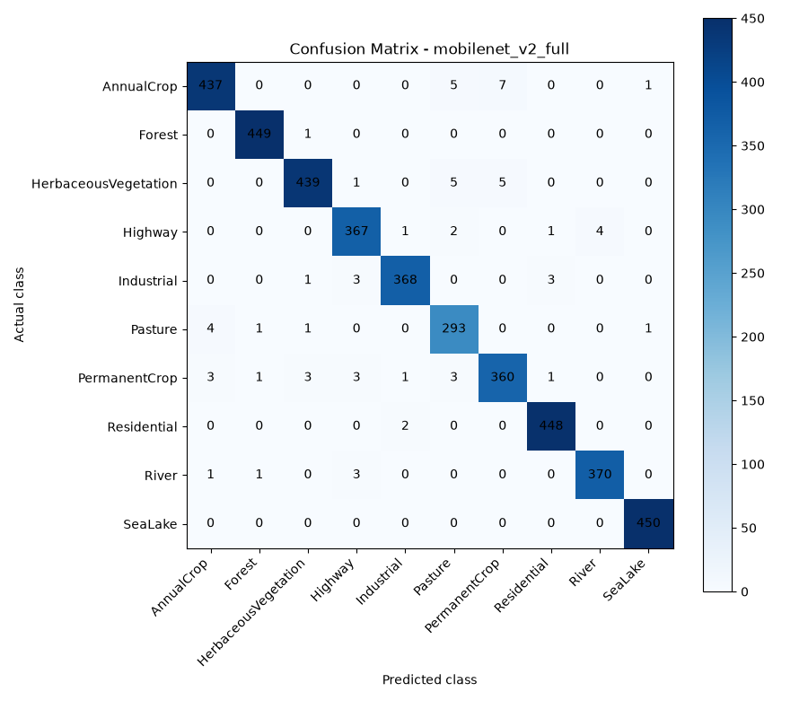
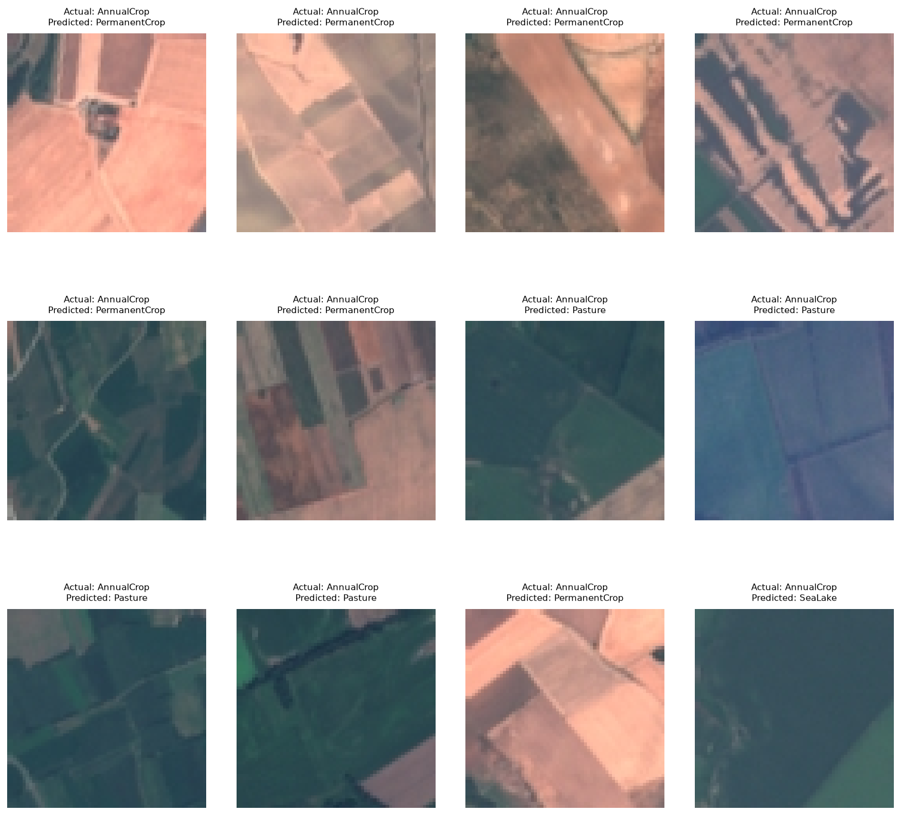
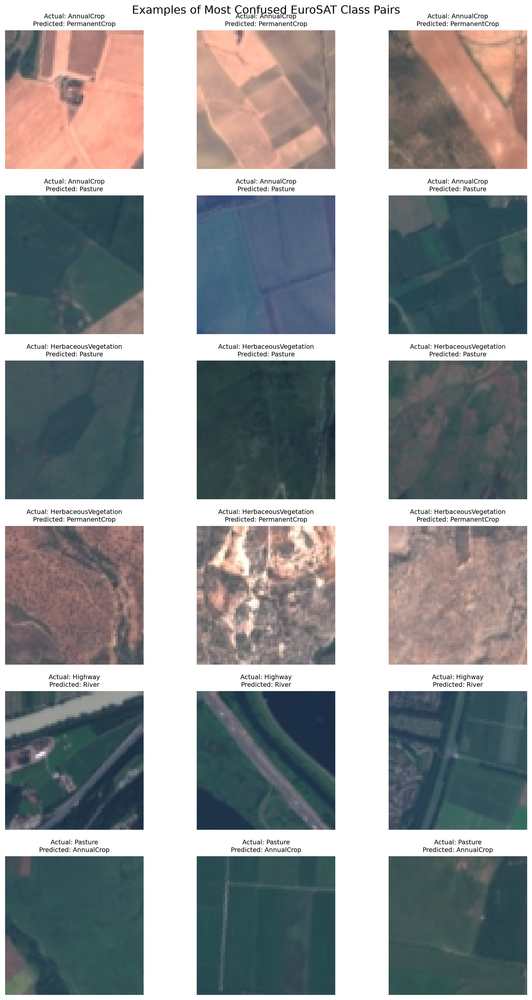
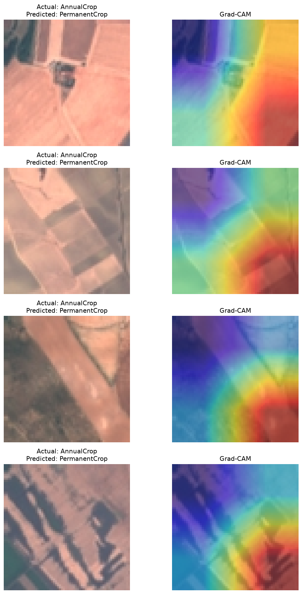
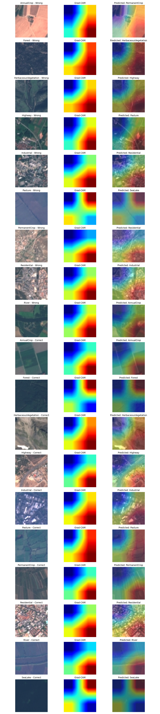
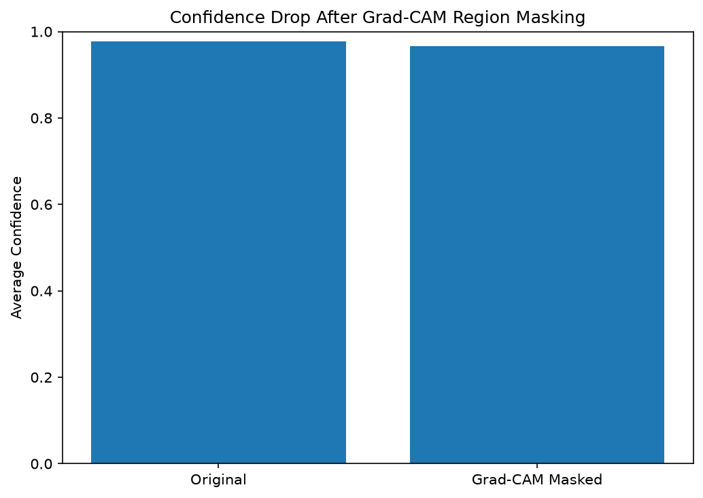
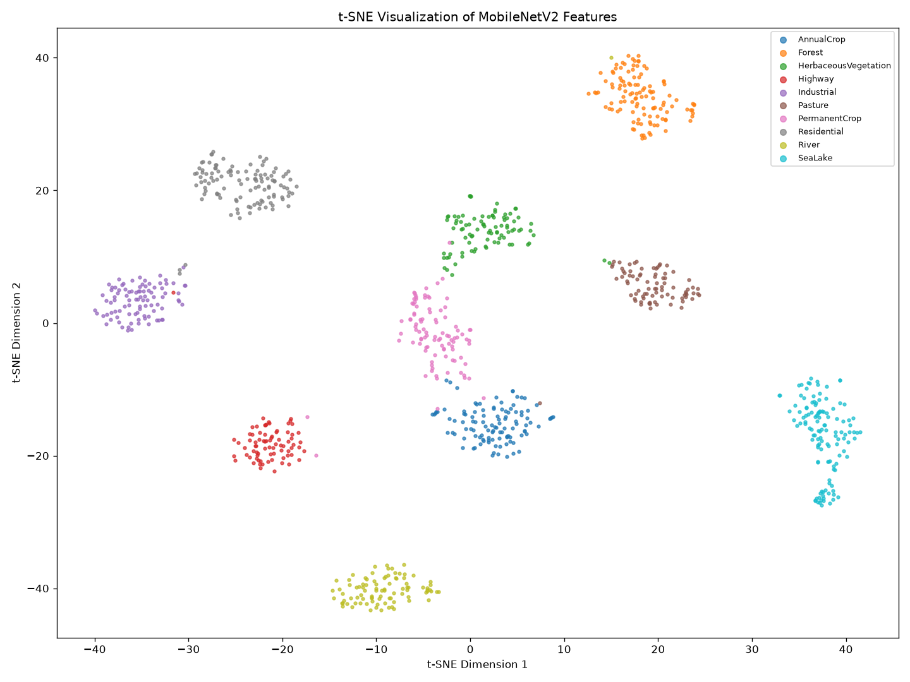

# Part E: Evaluation, Error Analysis, and Explainability

## 1. Model Evaluation

MobileNetV2 was evaluated on the fixed EuroSAT test set containing 4,050 satellite images across 10 land-use classes.

| Metric | Result |
|---|---:|
| Test Accuracy | 98.30% |
| Macro-F1 | 98.20% |
| Correct Predictions | 3,981 |
| Incorrect Predictions | 69 |
| Test Images | 4,050 |

The model achieved high accuracy and Macro-F1, indicating strong classification performance across the land-use classes.

## 2. Confusion Matrix Analysis

The confusion matrix shows that most classes were classified correctly.

- SeaLake: 450/450 correct.
- Forest: 449/450 correct.
- Residential: 448/450 correct.
- HerbaceousVegetation: 439/450 correct.
- AnnualCrop: 437/450 correct.

Agricultural classes showed the most confusion because their satellite images can contain similar vegetation patterns and field structures.

## 3. Misclassification Analysis

The model made 69 incorrect predictions.

The most frequent confusion pairs were:

| Actual Class | Predicted Class | Errors |
|---|---|---:|
| AnnualCrop | PermanentCrop | 7 |
| AnnualCrop | Pasture | 5 |
| HerbaceousVegetation | Pasture | 5 |
| HerbaceousVegetation | PermanentCrop | 5 |
| Highway | River | 4 |
| Pasture | AnnualCrop | 4 |

AnnualCrop, PermanentCrop, and Pasture can have similar textures and vegetation patterns. Highway and River can also appear similar because both may contain long, narrow structures.

### 3.1 Confused Class Pair Examples

The following figure presents representative misclassified images from six frequently confused class pairs. These examples help illustrate the visual similarity between land-use categories.

## 4. Grad-CAM Explainability

Grad-CAM was used to visualize image regions that influenced MobileNetV2 predictions.

The visualization contains:
- Original satellite image.
- Grad-CAM heatmap.
- Heatmap overlay on the original image.

The highlighted regions provide a visual explanation of the model's prediction. However, Grad-CAM does not prove that the model understands the complete land-use scene.

### 4.1 Grad-CAM for All 10 Classes

Grad-CAM was generated for all 10 EuroSAT classes.

- 10 correctly classified images, one per class.
- 9 misclassified images, one per class where available.
- Total: 19 representative images.

Each example includes the original image, heatmap, and overlay with the predicted class.

## 5. Grad-CAM Confidence-Drop Experiment

The confidence-drop experiment was performed on 50 correctly classified test images.

The top 20% of pixels with the highest Grad-CAM importance scores were masked.

| Measurement | Average Confidence |
|---|---:|
| Original | 97.72% |
| After Masking | 96.64% |
| Average Drop | 1.08 percentage points |

The confidence decreased slightly after masking. This suggests that the highlighted regions contributed to predictions, while other image regions may also contain useful information.

The experiment should be interpreted cautiously because masking can introduce artificial patterns into satellite images.

## 6. t-SNE Feature Visualization

MobileNetV2 feature representations were extracted for 1,000 test images and visualized using t-SNE.

The experiment used:
- 1,000 test images.
- Fixed random seed: 42.
- Perplexity: 30.
- MobileNetV2 feature dimension: 1,280.

t-SNE reduces high-dimensional features to two dimensions for visualization. Images with similar feature representations may appear close together.

The visualization helps examine class clustering and overlap. However, t-SNE distances should not be interpreted as exact measurements of similarity.

## 7. Data-Efficiency Experiment

Scratch CNN performance was evaluated using different training-data fractions.

An additional experiment was conducted using random seed 4 for fractions 5%, 10%, and 25%.

| Training Fraction | Images | Accuracy | Macro-F1 |
|---|---:|---:|---:|
| 5% | 945 | 74.69% | 73.96% |
| 10% | 1,890 | 81.68% | 80.92% |
| 25% | 4,725 | 87.43% | 86.81% |

Performance increased as more training images were used. This indicates that the scratch CNN benefits from additional training data.

## 8. Conclusion

MobileNetV2 achieved 98.30% test accuracy and 98.20% Macro-F1 on EuroSAT. Most classes were classified correctly, while agricultural categories showed the largest confusion.

Misclassification examples and Grad-CAM visualizations helped examine model behavior. The confidence-drop experiment provided an additional check of highlighted image regions.

The t-SNE visualization helped explore the structure of learned features. The data-efficiency experiment showed that scratch CNN performance improved with increased training data.

### Limitations

- The dataset contains a fixed set of land-use classes.
- Visually similar classes can still be confused.
- Grad-CAM provides approximate explanations rather than proof of model reasoning.
- t-SNE is a visualization technique and does not preserve all original feature relationships.
- Results on EuroSAT may not directly generalize to other satellite datasets.

### Possible Improvements

- Evaluate the model on additional satellite datasets.
- Investigate confusing agricultural class pairs.
- Compare different image resolutions.
- Explore additional explainability methods.
- Test performance on images from different geographical regions.
